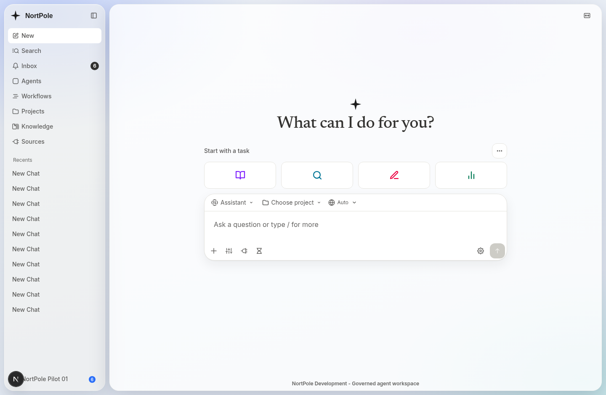
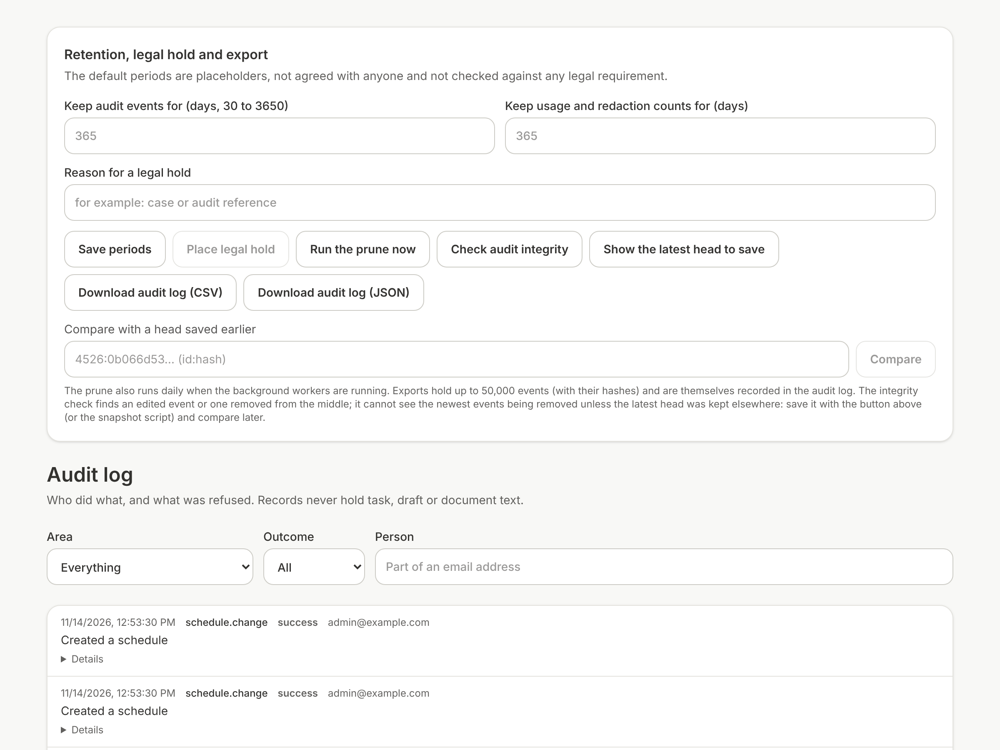
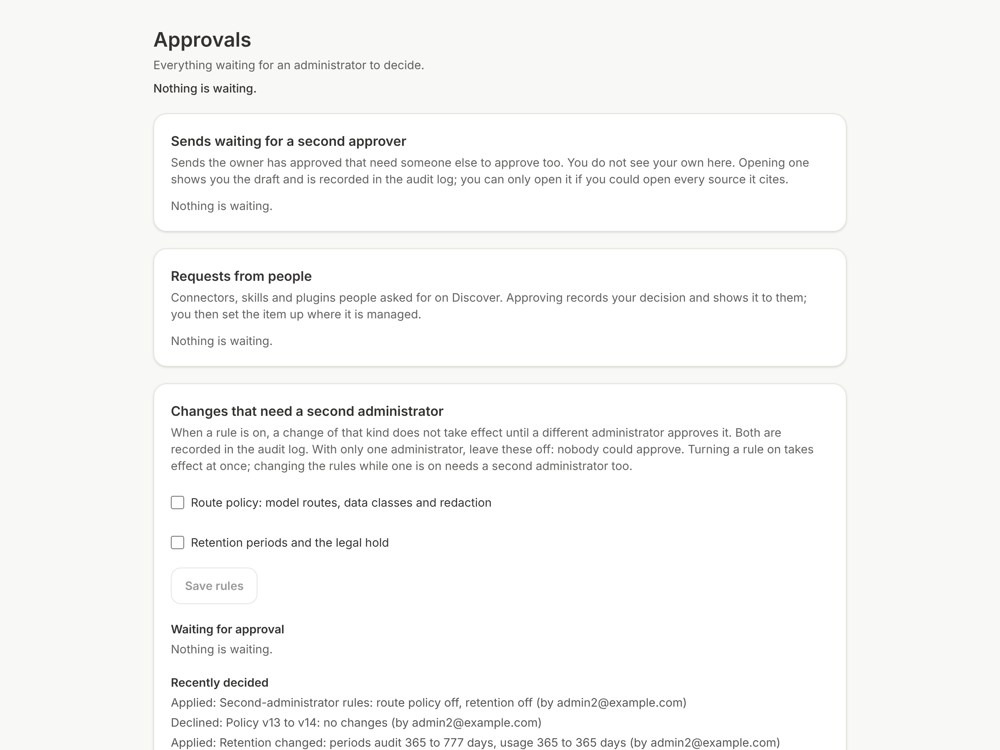
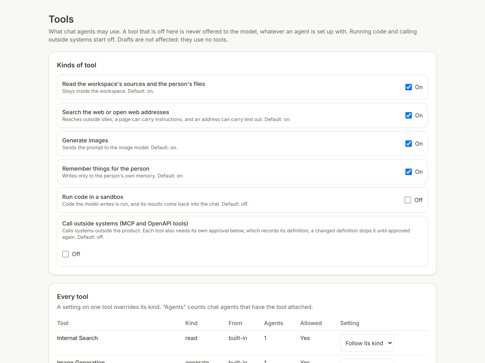
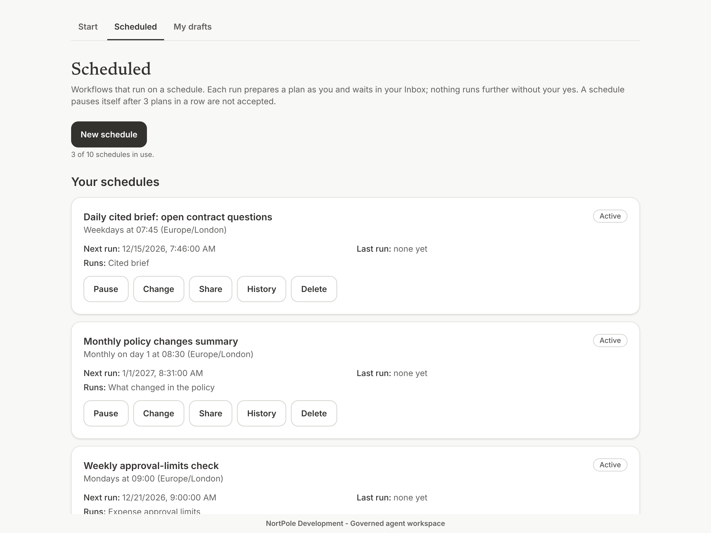
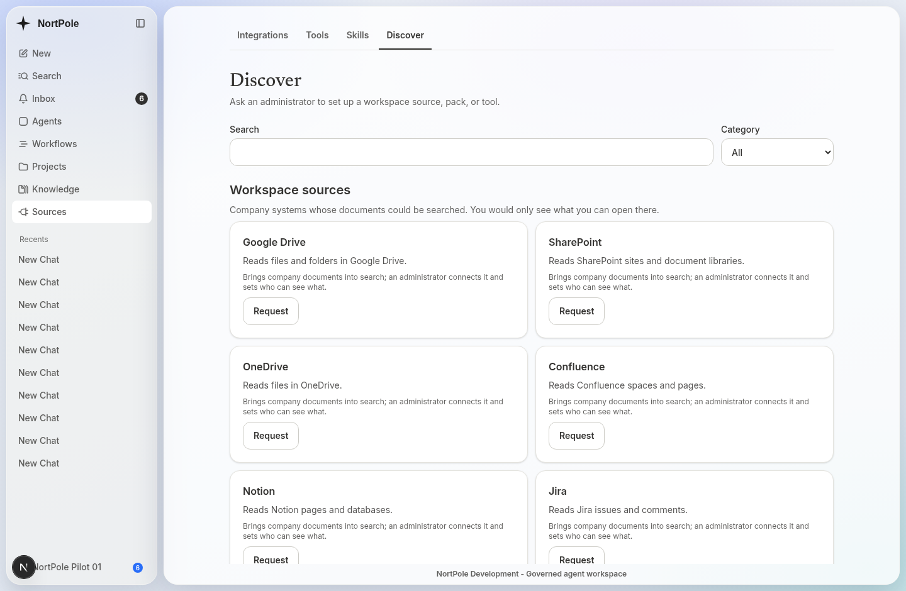
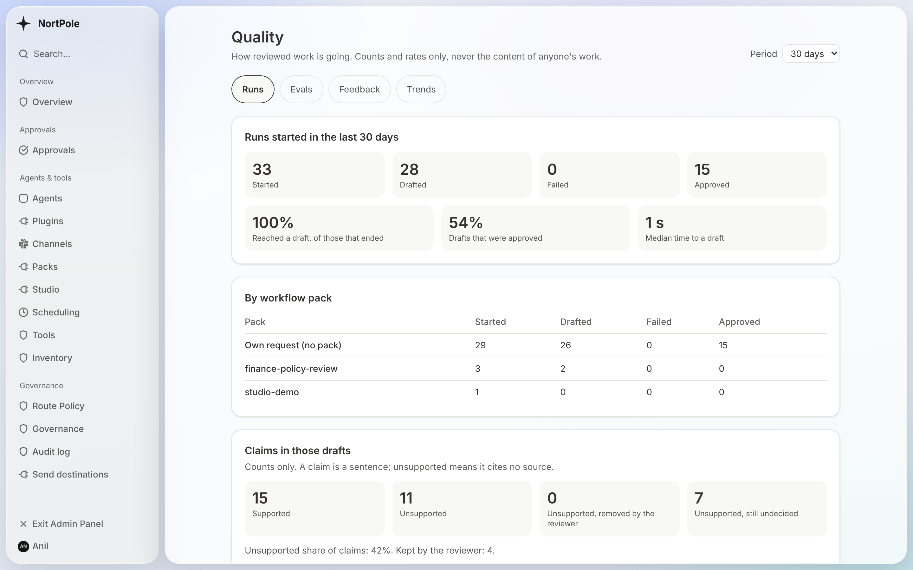
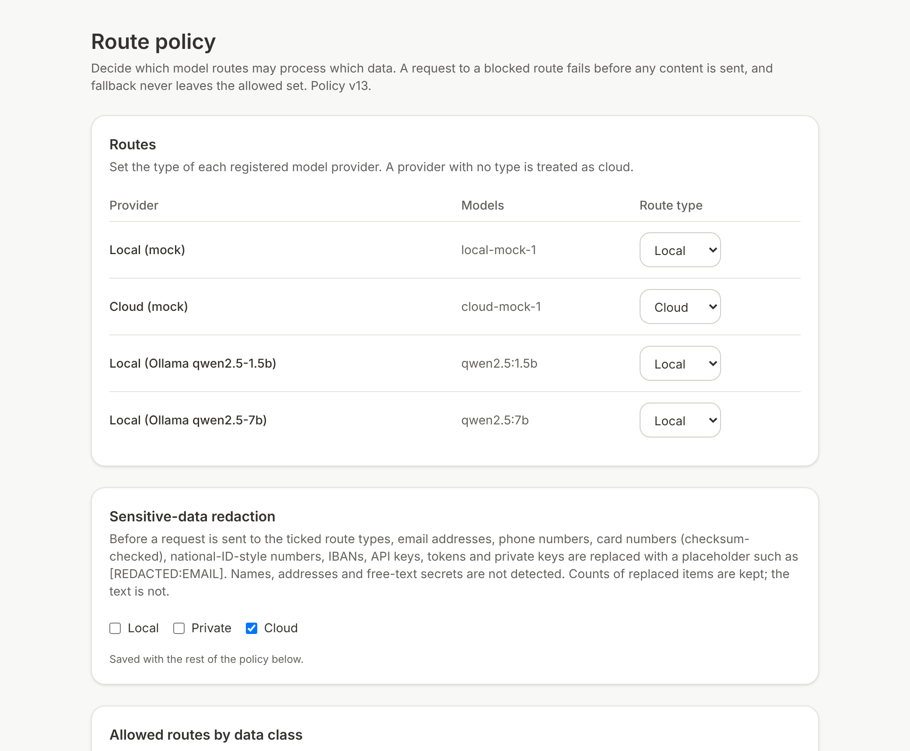
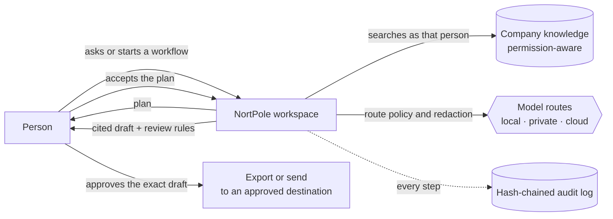
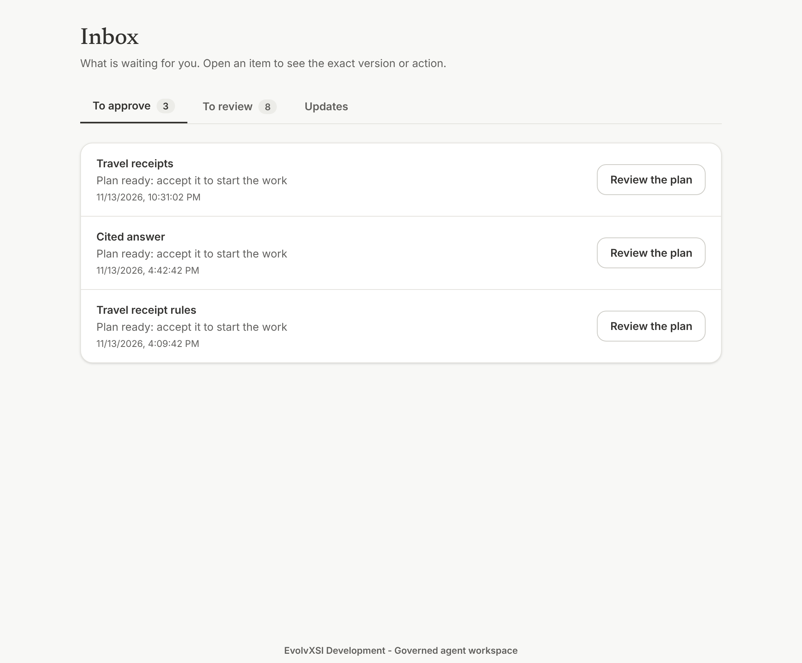

# NortPole

**The governed AI workspace for teams that cannot afford a wrong answer.**

NortPole lets teams ask questions over company knowledge, use reusable agents, and run workflows that produce cited drafts. In a reviewed workflow, you approve the plan before work runs and approve a specific draft before it is sent. Knowledge access follows each user's permissions, and governance events are recorded in a tamper-evident audit log.

> **Status: pilot preview.** The product runs end to end and is tested in a sandbox with local models. We are looking for **design partners** — one team, one workflow — for a first pilot. See [Work with us](#work-with-us).

---

## The AI workspace

The sidebar lists these destinations in order. **Recents** appears below the main navigation.

| In the workspace | What it does |
|---|---|
| **New** | Start a chat or use a task starter. Choose an available agent, model route, project, or context. |
| **Search** | Search accessible Knowledge, chats, and workflow activity from one page. |
| **Inbox** | Review plans and drafts that need attention and follow updates on your requests. |
| **Agents** | Open **Agent Catalog** to find company, shared, personal, or starred agents and start a chat. Authorized members can create agents. |
| **Workflows** | Start a versioned workflow, manage schedules, and find drafts and runs. |
| **Projects** | Search, open, and create projects from a single page. Keep related chats, files, instructions, and outputs together. |
| **Knowledge** | Browse accessible collections and manage personal files when enabled. |
| **Sources** | Browse **Integrations**, **Tools**, **Skills**, and **Discover**. Connect permitted integrations, manage reusable instructions, and request workspace capabilities. |

Administrators use **Admin Panel** for approvals, route policy, packs, tools, access, audit, and quality. See the [workspace guide](docs/02-product/NortPole_Product-Overview.md#the-enterprise-workspace) for how the destinations work together.

## Core features

| | Feature | What you get |
|---|---|---|
| **Trust** | Cited answers | Every statement links to the passage it came from; unsupported sentences are flagged, and a draft with nothing to cite says so instead of guessing. |
| | Permission-aware knowledge | Answers only use documents each person may open in the source system; Google Drive sharing is applied per document. |
| | Audit log | A hash-chained, tamper-evident record of refusals, approvals, sends, policy changes and exports, with integrity checks, a savable head, and export. |
| **Control** | Route policy and redaction | Mark each model as local, private or cloud, decide which class of data may go where, and redact sensitive patterns before the cloud. Blocked requests fail before anything is sent. |
| | Approvals | Accept the plan before work runs and approve one exact draft before anything leaves; optional second approver for sends, and optional two-administrator rules for route policy, retention, packs, send destinations and the tool catalog, all in one queue. |
| | Tool governance | A catalog of what assistants may use; outside tools (MCP, OpenAPI) stay off until approved, with pinned definitions that stop the tool if they change. |
| | Retention and legal hold | Set how long records are kept and hold them when needed. |
| **Work** | Governed workflows | Ready-made, versioned workflows: plan, gather sources, cited draft, review rules, approve, export or send. |
| | Signed packs and Studio | Workflows ship as signed packs that run only on models they passed evaluation on; administrators build their own in Studio. |
| | Workflow agents | Agents plan their searches first, run as you over the sources you can open, and can never send anything. |
| | Scheduled workflows | Recurring runs prepare the plan and wait in your Inbox; nothing continues without your yes, and a schedule pauses itself if plans go unaccepted. |
| | Inbox | One place for plans to approve, drafts to review and updates. |
| | Sources catalog | Browse integrations by category, connect an account or request workspace setup, and request eligible tools from their rows. Discover groups requests for workspace sources, packs, and tools and tracks their decisions. Chat can use permitted read actions from installed integrations. Proposed writes wait for approval in Inbox. |
| | Skills | See the built-in skills available to your account and the skills supplied by active packs. Create, import, edit, share, and enable custom skills according to your permissions. |
| **Insight** | Quality and cost | Draft and approval rates, unsupported-claim share, evaluation results per model, scheduled runs, and tokens and estimated cost per route. |

<table>
<tr>
<td width="50%" valign="top"> <b>Audit log</b>: retention, legal hold, integrity checks, a head to save, export, and a searchable record of who did what.</td>
<td width="50%" valign="top"> <b>Approvals</b>: one queue for second-approver sends, requests from people, and changes that need a second administrator.</td>
</tr>
<tr>
<td width="50%" valign="top"> <b>Tool governance</b>: what assistants may use; running code and outside systems start off.</td>
<td width="50%" valign="top"> <b>Scheduled workflows</b>: recurring runs that prepare a plan and wait for your yes.</td>
</tr>
<tr>
<td width="50%" valign="top"> <b>Discover</b> lets members find and request workspace sources, packs, and tools.</td>
<td width="50%" valign="top"> <b>Quality and cost</b>: runs, drafts, approvals and unsupported claims per pack.</td>
</tr>
</table>

## Why NortPole

Most AI assistants are built to be helpful first and safe second. In finance, legal, HR, compliance and operations that order is backwards: an invented answer, a leaked document or an unreviewed email costs more than the time AI saves.

NortPole starts from the other end:

| You need | NortPole gives you |
|---|---|
| Answers you can check | Every statement cites the passage it came from; unsupported sentences are flagged, and a draft with nothing to cite says so instead of guessing. |
| People to stay in charge | A plan you accept before work runs, and approval of one exact draft before anything is sent — with an optional second approver. |
| Data to stay where it belongs | A route policy decides which model (local, private or cloud) may see which class of data, and redacts sensitive patterns before anything goes to the cloud. |
| Answers to respect access | The system only reads what each person may open in the source system (Google Drive sharing is applied per document; the live Drive pilot is next). |
| Proof for auditors | A hash-chained audit log of refusals, approvals, sends, policy changes and exports, with integrity checks and export. |

## What people can do

- **Ask, with sources.** Chat over company knowledge; answers cite what they used.
- **Run a workflow.** Pick a ready-made workflow (a cited brief, find the policy that covers a question, compare two documents), review the plan, get a cited draft, approve it, export or send it.
- **Let an agent prepare the work.** Workflow agents plan their searches first and run only what you accept — as you, over the sources you can open, and they can never send anything.
- **Put work on a schedule.** A weekly check runs on its own, prepares the plan, and waits in your Inbox. Nothing runs further without your yes, and a schedule pauses itself if its plans keep going unaccepted.
- **Keep track in one Inbox.** *To approve*, *To review* and *Updates* — plans waiting for you, drafts ready to check, decisions on your requests.
- **Install and connect.** Browse **Sources → Integrations** to connect a permitted account or request workspace setup. Open an indexed source's **View Knowledge** link to see the accessible collections that use it.

## What administrators control

- **Model routes and data classes.** Mark each model as local, private or cloud; decide which data may go where; turn on redaction per route. A blocked request fails before anything is sent.
- **Signed workflow packs.** Workflows ship as signed, versioned packs that run only on models they passed evaluation on, with review rules and house style built in. A pack belongs to the signer of its newest version, so another signer cannot take it over without an administrator's approval. A Studio form lets administrators build their own.
- **Integrations.** Allow, require approval for, or block each integration or whole category; see how many people installed and connected each; opening write actions to everyone needs a confirmation. Stored secrets are sealed with your key.
- **Tools and outside systems.** A tool catalog decides what chat assistants may use; outside tools (MCP, OpenAPI) are off until approved, their definition is pinned, and a changed definition stops the tool until approved again.
- **Approvals in one place.** Sends that need a second approver, changes that need a second administrator (route policy, retention, packs, send destinations, the tool catalog), requests from people, tool definitions.
- **Scheduling, retention and audit.** Who may schedule; how long records are kept and a legal hold; audit-log integrity checks, a head you can save off the machine and compare later, and export.
- **Quality and cost.** Draft and approval rates, unsupported-claim share, evaluation results per model, scheduled-run counts, and tokens and estimated cost per route.

## How it works

1. **Request.** A question, a workflow from a signed pack, or a scheduled run.
2. **Plan.** The model proposes the steps — drafted on a route the policy allows — and you accept or revise it.
3. **Gather.** Searches run as you, over the sources you may open.
4. **Draft.** A cited draft is checked against the pack's review rules; unsupported claims are flagged.
5. **Approve.** You approve one exact version; sending to an outside system can require a second person.
6. **Record.** Each step is written to the audit log.

## Built for your environment

- **Self-hosted.** Docker Compose profile with TLS, backup and restore, version pinning and a release manifest ([staging profile](infrastructure/profiles/staging/README.md)).
- **Your models.** Run local models (for example through Ollama) for sensitive data and add private or cloud routes as policy allows.
- **Your knowledge.** Connectors bring company documents into search with their access rules; Google Drive permission sync is built, and more sources follow per customer.
- **Accessible.** Light and dark themes, phone-width layouts and keyboard navigation, checked against WCAG 2.1 AA with axe.

## Status and roadmap

**Built and tested (sandbox, local models):** workspace and admin console, reviewed workflows with plans and approvals, workflow agents, scheduled workflows, signed packs and Studio, route policy and redaction, tool catalog and outside-tool approval, second approver and two-administrator rules, audit log with integrity checks, retention and legal hold, Discover and requests, Inbox, Quality, and Google Drive permission sync, an integrations catalog with per-person accounts, approvals, sealed secrets, OAuth sign-in (fake provider only), chat use of installed integrations (reads directly, writes as proposals approved in the Inbox) and personal skills.

**Next:** a live Google Drive pilot with a search index, knowledge domains (open or restricted areas with verified documents), event-triggered workflows, and hardening for a first customer deployment (identity provider and MFA, hosting, a cloud model route).

**Not yet:** a production deployment, single sign-on, and a third-party security review. All results so far come from sandbox testing. Of the 13 integration definitions, 8 were checked against the vendors' API reference and one (Wikipedia's page summary) was sent to the live service; the other 4 (Airtable, Dropbox, Webflow, HubSpot) are unchecked, and none has been used with a real account. OAuth sign-in has only been tried against a fake provider. Chat use of integrations has been tested with a stand-in model, not a real one. The two-administrator rule does not yet cover installing a pack, and workflows cannot call integrations yet.

The full, honest list lives in the [pending-work checklist](docs/07-implementation/NortPole_Pending-Work-Checklist.md), and what each piece checked is in the [review log](docs/REVIEW.md).

## Work with us

We are looking for a **design partner**: a team with one high-stakes, document-heavy workflow — policy questions, contract review, audit evidence, compliance checks — that would pilot NortPole on its own documents and models.

To talk about a pilot, email [vanilkumarch@gmail.com](mailto:vanilkumarch@gmail.com).

## For developers

| Part | Where |
|---|---|
| API and core services (Python, FastAPI) | [services/core](services/core) |
| Web workspace (Next.js) | [apps/workspace](apps/workspace) |
| Workflow packs | [packs](packs) |
| Deployment profiles | [infrastructure/profiles](infrastructure/profiles) |
| Product and architecture documents | [Document index](docs/README.md), [Product definition](docs/02-product/NortPole_Product-Definition.md), [System architecture](docs/06-technical/NortPole_System-Architecture.md) |

Run `make help` for common commands and `make check` to check the repository layout and document links. The layout and its rules are in the [repository structure](docs/06-technical/NortPole_Repo-Structure.md).
