# EvolvXSI — deployment architecture

Status: proposed target topology; not implemented · Updated: 2026-11-05

This document specifies deployable units, processes, persistence, network boundaries and scaling. The system architecture document describes the logical responsibilities. The monorepo groups the product modules. Deployment groups processes by isolation, workload and recovery needs. This is a target for EvolvXSI-owned services; downloaded projects are reference material and are not implementation foundations.

## Physical topology

```mermaid
flowchart TB
  USER[Web browser]
  IDP[OIDC identity provider]
  EXT[Enterprise applications]
  CLOUD[Approved cloud model APIs]
  LOCAL[Customer-local inference endpoint]

  subgraph EDGE[Public edge]
    INGRESS[TLS ingress and rate limiting]
    WEB[Workspace web application and BFF]
  end

  subgraph PRIVATE[Private application network]
    CONTROL[Control API: tenants, tasks, registry, approvals]
    RUNAPI[Execution API: runs, artifacts, event stream]
    COORD[Run coordinator, scheduler and outbox relay]
    KNOW[Knowledge API and permission filtering]
    INGEST[Ingestion workers]
    MODEL[Inference gateway]
    CONNECT[Connector and tool workers]
  end

  subgraph DATA[Private data network]
    PG[(PostgreSQL: service-owned schemas)]
    INDEX[(Knowledge index: text and vectors)]
    QUEUE[(Work queue: dedicated Redis)]
    CACHE[(Ephemeral cache: separate Redis)]
    STORE[(Object storage: sources, artifacts, packages)]
    SECRET[Secret manager and encryption keys]
    TELEMETRY[Telemetry collector and restricted log store]
  end

  subgraph ISOLATED[Isolated execution network]
    AGENT[Agent worker pool]
    SANDBOX[Ephemeral code and browser jobs]
  end

  subgraph GPU[Private inference network]
    SERVE[Model-serving workers on GPU nodes]
  end

  USER -->|HTTPS| INGRESS
  INGRESS --> WEB
  WEB -->|Login| IDP
  WEB -->|Authenticated HTTPS| CONTROL
  WEB -->|Authenticated HTTPS and SSE| RUNAPI
  CONTROL --> PG
  RUNAPI --> PG
  COORD --> PG
  COORD --> QUEUE
  QUEUE --> AGENT
  QUEUE --> INGEST
  QUEUE --> CONNECT
  AGENT -->|Checkpoint and status| RUNAPI
  AGENT -->|Evidence query| KNOW
  AGENT -->|Inference request| MODEL
  AGENT -->|Sandbox dispatch| SANDBOX
  AGENT -->|Scoped tool job| CONNECT
  INGEST --> KNOW
  INGEST -->|Embeddings| MODEL
  KNOW --> INDEX
  KNOW --> PG
  KNOW --> STORE
  CONNECT -->|Approved outbound HTTPS| EXT
  MODEL --> CLOUD
  MODEL --> SERVE
  MODEL -->|Authenticated customer bridge| LOCAL
  MODEL --> CACHE
  MODEL --> PG
  RUNAPI --> STORE
  COORD --> SECRET
  CONNECT --> SECRET
  MODEL --> SECRET
  CONTROL -.-> TELEMETRY
  RUNAPI -.-> TELEMETRY
  COORD -.-> TELEMETRY
  MODEL -.-> TELEMETRY
  KNOW -.-> TELEMETRY
```

Connections show ownership and transport, not execution order. No database, queue, gateway, or model-serving endpoint is public. All service calls authenticate their caller and authorize tenant scope. Ingestion, workers and sandboxes also send redacted telemetry through the collector.

## Proposed runtime choices

P00 selects the stack and topology. JSON over HTTPS with SSE, PostgreSQL authoritative state, colocated text/vector indexes, object storage and separate Redis dispatch/cache instances are proposals, not selected dependencies. The fixture may start with database-backed jobs/outbox and no separate broker, cache or object store if its tests pass. Add those components only when the selected workload needs them. Knowledge keeps index internals behind its contracts.

An initial developer environment uses container composition. A possible production target uses a container cluster with separate CPU worker, sandbox and optional GPU node pools; P00/P10 must select and validate the actual profile. Do not add a service mesh, several workflow engines or several vector stores before a demonstrated requirement. Exact hosting provider, application framework versions, model server and orchestration libraries remain implementation choices documented in the separate reference material.

## Deployable units

| Unit | Processes and responsibility | State owner | Scale signal |
| --- | --- | --- | --- |
| Workspace | Frontend server and browser-facing API adapter. | Sessions through identity provider; no authoritative run state. | HTTP concurrency and latency. |
| Control API | Tenant/project/task configuration, publication, registry and approval endpoints. | Control schema. | API latency and request rate. |
| Execution API | Run control, artifact versions, export download authorization and persisted event streaming. | Execution schema and artifact object prefix. | Request rate and streaming connections. |
| Coordinator | Due schedules, outbox publication, expired leases and run recovery. | Execution job/outbox tables. | Dispatch lag; lease-based coordination. |
| Agent workers | Execute one pinned agent/workflow per run attempt and checkpoint safe boundaries. | Execution API; workers do not own independent state stores. | Queue depth, oldest job age, active run limits. |
| Knowledge API | Authorized search, citations, provenance and scoped memory. | Knowledge schema and index. | Search latency and index load. |
| Ingestion workers | Fetch, parse, chunk, embed and refresh source ACLs. | Knowledge API/schema under its own credentials. | Ingestion backlog and source rate limits. |
| Inference gateway | Destination policy, provider credentials, routing, fallback and usage accounting. | Inference schema and ephemeral cache. | In-flight inference, token throughput and budgets. |
| Connector workers | Host packages/integrations adapters for authorized remote actions or source sync. | Execution owns action receipts/reconciliation; Knowledge owns sync cursors/ACL state. No independent connector schema. | Provider rate limits and owner-specific queue backlog. |
| Sandbox jobs | Per-task code/browser containers or stronger isolated machines for untrusted code. | Restricted temporary files; approved outputs uploaded through scoped access. | CPU/memory slots, job age and tenant quotas. |
| Evaluation jobs | Execute versioned suites and produce release reports. | Versioned reports and evaluation records. | Explicit CI/batch concurrency. |
| Private model servers | Load selected models and serve inference. | Model weights and capacity state. | GPU memory, queue wait and token throughput. |

API and coordinator code may ship from the same execution module in different process modes. Agent and connector processes may share an image initially but have separate queues, credentials and resource limits. This permits independent scaling without premature duplication of code.

## Durable state and message delivery

PostgreSQL is authoritative for tasks, run state, approvals, job attempts, event sequence and artifact metadata. Redis is dispatch infrastructure, not the only copy of a job. A database outbox records work in the same transaction as its state change. Relays enqueue job identifiers; workers claim jobs with leases. Duplicate delivery is expected. Expired leases are reconciled against checkpoints, and dispatch can be reconstructed from database records after queue loss.

A coordinator replica claims due jobs using transactional locking or leases. A second replica cannot advance the same run transition concurrently. Queue messages contain identifiers and safe references, not source documents or secrets. SSE reconnects replay persisted events by sequence rather than relying on a worker remaining connected.

External writes have deduplication keys and immutable approval bindings. A timed-out remote request can have succeeded; reconcile that outcome before retry. Where the remote API cannot prove the outcome, stop for manual resolution. Cancellation blocks new actions at safe boundaries but cannot undo completed writes.

## Storage isolation

Start with a shared PostgreSQL server only if service schemas, credentials and migrations remain separate. Control owns configuration and decisions; execution owns runs/artifacts; knowledge owns source ACLs and indexes; execution owns tool receipts/reconciliation and knowledge owns source sync state; inference owns route accounting. Cross-service access uses APIs/events, never cross-schema business queries. A future customer-isolated deployment can move each owner to a separate database without changing public contracts.

Object storage is private. Protected downloads pass through an authorization endpoint that rechecks current artifact and source access for each new request, including range requests. A raw presigned storage URL that remains valid after revocation does not satisfy this requirement. Client download tokens must resolve through current authorization or be invalidated by the serving layer. Source revocation blocks derived artifacts and new downloads until redaction/regeneration. Already downloaded files cannot be recalled. Backups, retention, recovery objectives and geographic placement must be selected before production.

## Trust and policy enforcement

The browser authenticates through OIDC. APIs validate user/service identity and independently enforce tenant scope. Worker dispatch issues a scoped run authorization context, not unrestricted user credentials. Agent and skill manifests request capabilities; effective authority is the intersection of tenant policy, actor permission, published definition and current run grants.

Secrets are retrieved by trusted gateways or connectors. Sandboxes receive scoped access, not platform-wide credentials. Default sandbox egress is denied; permit only required destinations. The inference gateway is the approved path to model destinations. Tenant data policy covers embeddings, parsing services, evaluation and tracing as well as generation.

Approval decisions belong to the control plane; the pending run belongs to execution. Decisions are delivered idempotently and bind tenant, run, step, actor and artifact version or payload digest. Recheck applicable permissions and current policy before acting. Fail closed when current authority cannot be established.

## Agent, skill and vertical-package distribution

These are versioned packages in the monorepo. CI builds immutable versioned packages, scans/tests them and publishes signed artifacts or recorded content digests. The control registry stores approved versions and compatibility. Workers fetch the pinned versions and verify their digest. Packs include agents, domain skills, workflows, schemas, review views, templates, policies and evaluation cases. UI extensions require a controlled host contract; a pack cannot execute arbitrary privileged frontend code by declaring a view.

## Production boundaries and rollout

For a first pilot, colocate control and execution API processes when operating cost warrants it; keep their ownership, credentials and contracts explicit. Deploy workers separately from request handling. Activate one source, one inference route and one vertical. Separate knowledge ingestion, connector pools and private inference when the pilot demonstrates the need. The target diagram describes proposed services, not implemented capabilities.

Initial availability comes from restartable services, durable checkpoints and tested backups. Production redundancy requires multiple API/worker replicas, coordinated schedulers, highly available data services and failure-domain separation. Select numeric latency, throughput, RPO/RTO and cost targets with the pilot owner; no capacity figure is asserted before load testing.

## Current implementation direction

EvolvXSI owns the service logic and public contracts. Use official provider clients behind internal adapters. Downloaded application and agent-framework sources are reference material; earlier extraction suggestions are not selected dependencies. The optional agent-loop SDK choice remains separate from the API client choice. See the [dependency decision](../07-implementation/EvolvXSI_Provider-SDK-Decision.md).

## Start and event ownership

Task creation in control stores a draft only. The explicit run-start endpoint belongs to execution, which validates task access through control and transactionally persists the run, job, idempotency result and dispatch outbox. Its coordinator relays only execution-owned outbox records. Control has its own relay for approval/configuration events, and knowledge has its own relay for source-access events. Consumers record processed event IDs in their own inbox; no relay reads another service's tables. Current authority is rechecked at protected actions even when an event is delayed.

## Layer placement

L10 owns deployment. Record application, source index, artifact storage, model inference and telemetry placement separately. L07 checks the current L04 destination policy before each inference request.

## Fixture versus target topology

The diagram is a target decomposition, not a list of processes required for B01. Select only the components needed for the fixture, retaining explicit state ownership and durable recovery. In the proposed database/broker topology, the database is authoritative and the broker is reconstructable. Equivalent ownership and recovery guarantees are required if P00 selects another stack. Existing local/staging/production folders are placeholders, not tested deployment profiles.
