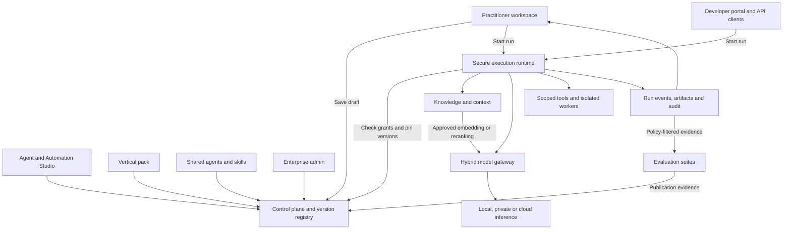
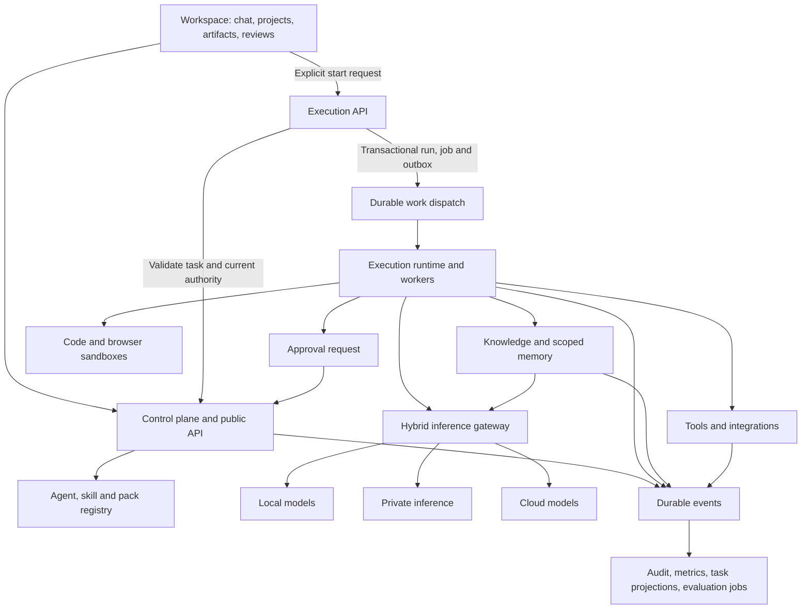

# EvolvXSI — system architecture

Status: proposed for review; implementation paused · Updated: 2026-11-05

For deployable services, storage, network boundaries and scaling, see the [deployment architecture](EvolvXSI_Deployment-Architecture.md).

## Ten engineering layers

These IDs are the canonical ownership map for EvolvXSI. A layer can span several modules, and several layers can share a deployment. The monorepo inventory records the physical layout.

| Layer | Responsibility | Monorepo owners |
| --- | --- | --- |
| L01 Portals & Surfaces | Practitioner workspace, Studio, admin, developer, operator and public experiences. | `apps/workspace`, `packages/ui` |
| L02 Agents, Skills & Vertical Packs | Versioned definitions, templates, domain rules and pack validation. | `packages/agents`, `packages/skills`, `packages/pack-sdk`, `packs/` |
| L03 Control Plane & Platform Contracts | Tenant, project and draft records, registry, publication, activation and versioned interfaces. | `services/control-plane`, `packages/contracts` |
| L04 Security, Policy & Governance | Actor identity, grants, policy decisions, exact-version approvals, and audit and retention rules. | `services/control-plane`, `packages/identity-policy`; every protected service enforces its own boundary |
| L05 Agent Runtime & Orchestration | Durable runs, scheduling, workers, checkpoints, retries, cancellation and artifacts. | `services/execution` |
| L06 Data, Knowledge & Retrieval | Ingestion state, source permissions, versioned passages, citations, libraries and scoped memory. | `services/knowledge` |
| L07 Model Gateway & Inference | Destination policy enforcement, provider adapters, routing, fallback and usage. | `services/model-gateway` |
| L08 Integrations & Ecosystem | Connectors, tools, credential references, webhooks and extension interfaces. | `packages/integrations`, with execution or knowledge hosts |
| L09 Observability & Evaluation | Run telemetry, diagnostic views, repeatable evaluation and version-bound publication evidence. | `evaluations`, execution event producers and workspace views |
| L10 Deployment & Platform Operations | Deployment profiles, service health, upgrades, backups, restore and rollback. | `infrastructure` |

L03 records registry and activation state. L04 defines authority and records approval decisions. L05 applies those decisions to the current run, with an access and policy check before protected actions. L06 owns retrieval authorization and provenance. L07 applies destination policy before sending content, including embedding requests and fallback. L09 provides evaluation evidence for L03 to enforce at publication. L10 operates the infrastructure used by all layers.

The [product definition](../02-product/EvolvXSI_Product-Definition.md) describes the ten product coverage areas. Discover, Create, Automate and Customize cross layers. Go-to-market uses the public surface and vertical packs and is owned by the commercial workstream. Cohere North is the product benchmark. This layer model belongs to EvolvXSI. Downloaded source projects serve as design references only.

## Horizontal platform and vertical packs

EvolvXSI gives practitioners one workspace for questions, tasks, evidence, reviews, and approved outputs. Workflow authors use Agent and Automation Studio to test and publish definitions. Administrators configure access and processing destinations. Developers invoke the same task and run contracts through the developer portal. Cohere North informs the breadth of these surfaces. EvolvXSI's design centers on whether a team can produce and verify a recurring deliverable within its own policies.

### What each layer owns

| Layer | Responsibility |
| --- | --- |
| Experience | The workspace shows the result beside its sources and approval state. Studio manages definitions and automations. Admin and developer views use the same tenant boundaries. |
| Vertical packs | A versioned pack supplies domain workflows, terminology, source mappings, templates, review requirements and evaluation cases. Its manifest pins shared skills and declares requested tools. |
| Horizontal control plane | Owns tenant membership, task drafts, activation grants, policy versions, the registry and approval decisions. Publication binds passing evaluation evidence to the exact candidate and dependencies. |
| Horizontal execution | Owns the run, checkpoints, cancellation, artifact versions and recovery. Both a scheduled trigger and a manual start enter the same authorized run lifecycle. |
| Knowledge, inference and tools | Knowledge filters passages and tracks provenance. The gateway enforces processing destinations and budgets. Integrations resolve scoped credentials and apply action limits. |
| Operations and evaluation | Correlated events explain outcomes, latency, failures and available cost. Evaluation compares versions on fixed cases. Deployment provides isolation, telemetry, storage and recovery. |

### Pack activation and a single run

Consider a manufacturing quality pack as an illustration. Its author defines what counts as a material procedure change, the brief's required fields and the reviewer's role. Shared skills compare documents and attach citations. A tenant administrator activates a tested version and grants access to selected sources and tools.

1. A practitioner saves a question as a draft, then explicitly starts the comparison. Execution validates authority, pins the activated versions and atomically records the run, job and dispatch intent.
2. Knowledge returns permitted passages from the old and new procedures. The gateway checks the permitted destination before model processing. When policy permits only local inference and that route is unavailable, the run reports the problem.
3. Execution produces a versioned brief with passage references and flags unsupported findings. The reviewer approves that exact version. A subsequent edit requires a fresh decision.
4. On reopening or exporting the brief, EvolvXSI checks current access to the artifact and its sources. Revoked access withholds affected content until redaction or regeneration. Run history and evaluation evidence follow the same access policy.

The pack defines the meaning and quality of the deliverable. The platform owns identity, run history, routing, approvals and export authorization across all packs. Shared agents and skills can be referenced directly. Downloaded open-source projects remain design references only.

## Execution and service boundaries

Use one monorepo with explicit module and service ownership. Definitions and packages have independent releases without becoming separate services. Scale worker execution, ingestion, inference, and connector workloads independently.

## Repository and ownership map

| Module | Owns | Release artifact |
| --- | --- | --- |
| apps/workspace | Chat, projects, agent studio, artifacts, review and admin views. | Web application |
| services/control-plane | Tenants, membership, tasks, policy versions, registry metadata and approval decisions. | API and migrations |
| services/execution | Agent loop, orchestration, run/step state, checkpoints, tool calls, artifacts and exports. | Worker images and migrations |
| services/model-gateway | Model adapters, data-destination checks, routing, fallback, budgets and usage. | Gateway and adapters |
| services/knowledge | Ingestion connections, document versions, source ACLs, passages, indexes, provenance and scoped memory. | API and ingestion workers |
| packages/integrations | Tool adapters, connection health, credential references and remote subscriptions. | Adapter packages; isolated services when needed |
| packages/agents | Shared agent definitions, roles, instructions, skill/tool requirements and collaboration patterns. | Definition packages |
| packages/skills | Shared skills, schemas, dependencies, permissions and skill-local evaluations. | Skill packages |
| packages/pack-sdk | Pack authoring helpers and manifest validation using canonical contracts. | SDK package |
| packages/contracts | Versioned API/event schemas, manifests and generated clients. | Contract packages |
| evaluations | Cross-service evaluation suites, rubrics and release reports. | CI and batch jobs |
| infrastructure | Compatible release sets, deployment profiles, monitoring and rollback configuration. | Deployment manifests |
| docs | Canonical product, architecture, decisions and separate reference research. | Documentation pinned to the product commit |
| packs/vertical/<domain> | Domain agents, skills, workflows, review views, templates, policies and evaluations. | Vertical package; optional specialized worker |

The product monorepo contains module skeletons; no application implementation or CI pipeline has been built. The current sources directory remains a collection of reference checkouts. Implement EvolvXSI-owned modules within these boundaries, using official provider clients behind internal adapters. Reference checkouts are excluded from product builds.

## Skills, agents, and hybrid intelligence

A skill is a versioned capability package with instructions, input/output schemas, dependencies, required permissions and evaluation cases. Scripts run in an isolated execution environment. Domain skills stay with their pack; shared skills have one owner in the skills repository. Declaring a permission never grants it.

An agent composes pinned skills, tools, instructions, limits and model requirements. The control plane publishes and activates definitions per tenant. Execution interprets them. Start with agent definitions and registry functions rather than adding an agent service that duplicates the runtime.

The hybrid gateway chooses an approved local, private, or cloud destination by data class, capability, quality, latency, cost and capacity. Fallback preserves all policy restrictions. Apply destination checks to embeddings, reranking, indexing, tracing and evaluations as well as generation. Model-serving infrastructure scales separately from the gateway. Implement one selected inference path first.

## Contracts

| Contract | Required content |
| --- | --- |
| Agent definition | Schema version, agent/version, pinned skills, allowed tools, model requirements and limits. |
| Skill manifest | Skill/version, input/output schemas, dependencies, permission declarations and evaluation reference. |
| Vertical manifest | Pack/version, platform compatibility, domain agents/skills, workflows, views, templates and evaluations. |
| Run request | Tenant, actor, task, pinned definition versions, input reference, policy version, idempotency key and correlation ID. |
| Approval | Tenant, run/step, exact artifact version or action-payload digest, approver, decision and resolution version. |
| Event envelope | Event/schema version, event ID, tenant, aggregate ID, sequence, correlation/causation IDs, timestamp and safe payload. |
| Inference request | Authorized caller, tenant, data class, destination constraints, capabilities, budget and usage correlation. |

Services consume released schemas and clients; they do not import another repository's live application source. Deployment manifests pin a compatible set of services, agents, skills and packs.

## Data and authority

Each service owns its schema and migrations. A pilot can share a database server with separate schemas and credentials, but services do not query one another's tables. Execution owns durable run state and artifacts; knowledge owns evidence and source permissions; the control plane owns identity integration, configuration and approval decisions. Secret values live in a dedicated store, outside prompts and manifests.

Generated artifacts retain source dependencies. Recheck permissions for retrieval, tools, approval consumption, artifact views and exports. Withhold content affected by revocation until safely redacted or regenerated. Approval cannot override a policy block. Changed action arguments or artifact versions require fresh approval. Control-plane decisions are delivered to execution through authenticated, idempotent contracts.

## End-to-end execution

1. Workspace creates a draft with POST /v1/tasks. The control plane authorizes and saves the task; this operation creates no run or execution job.
2. An explicit POST /v1/tasks/{id}/runs is routed to execution. Execution validates task access and current published definitions through control-plane contracts, then atomically records the run, job, idempotency result and dispatch outbox in its own database. It pins workflow, agent, skill and optional pack versions plus policy version.
3. The execution relay dispatches the job. Workers claim it idempotently and retrieve permitted evidence. Recheck current authority before protected work; ingestion and retrieval processing use approved inference destinations.
4. Execution invokes allowed tools and inference. Code and browser tasks run in isolated sandboxes with resource and network limits.
5. At a review point, execution checkpoints and requests a decision. The workspace displays the exact action or artifact version.
6. The control plane records the authorized decision. Execution checks matching payload/version, current permissions, policy and run state before resuming.
7. Execution records immutable artifact versions and provenance. Final approval binds to one version. Export downloads recheck source and derived-content access.
8. Events update task projections, audit records and usage metrics. Evaluation jobs use a pinned suite with explicit release thresholds.

## Reliability and scaling

Use at-least-once delivery, idempotent consumers, bounded retries, dead-letter handling and per-resource sequence checks. Do not assume exactly-once external actions. When an external request times out, reconcile the remote outcome before retrying; use manual resolution if safe deduplication is unavailable.

Execution is the initial checkpoint owner. Add another process engine only with an explicit state ownership boundary. Pause, cancellation and disablement stop new work at safe checkpoints; completed external actions cannot be reversed automatically.

Scale workers by queue depth and workload class, ingestion by backlog, and inference by concurrency and model capacity. Enforce tenant quotas, admission controls, backpressure, and run budgets. Separate code, browser and GPU worker pools when required. Extract connector services for independent load or credential isolation rather than creating one service per adapter.

## First delivery boundary

Start with the workspace, control plane, execution workers, contracts, deployment configuration and one selected vertical package. Introduce the knowledge and hybrid boundaries as retrieval and model access are implemented. Definition, skill and evaluation repositories publish packages/jobs rather than always-on services. No first vertical or deployment target is selected by this proposal.

Before rollout, verify tenant isolation, access revocation, approval binding, replay and deduplication, restart recovery, cancellation, destination restrictions and export access. Record quality, latency, cost, sample-size and reliability targets. Unauthorized disclosure, prohibited transmission and unapproved external writes block rollout. The PRD remains authoritative for customer scope and acceptance.

See [feature and architecture mapping](EvolvXSI_Feature-Architecture-Mapping.md) for repository ownership and first-workflow requirement coverage.

## Current implementation direction

EvolvXSI owns the service logic and public contracts. Use official provider clients behind internal adapters. Downloaded application and agent-framework sources are reference material; earlier extraction suggestions are not selected dependencies. The optional agent-loop SDK choice remains separate from the API client choice. See the [dependency decision](../07-implementation/EvolvXSI_Provider-SDK-Decision.md).

## Controlled improvement extension

See [learning environments](EvolvXSI_Learning-Environments.md) for offline candidate execution, verification and approval-bound promotion. Evaluation fixtures fit existing repositories; optional model training remains a later decision. Production definitions remain immutable and cannot self-modify.
