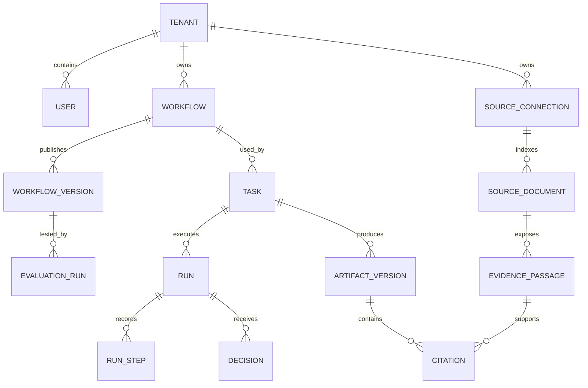

# NortPole — data model

> **Where this lives in code (2026-11-14).** Service and package names here (`services/control-plane`, `services/execution`, `services/knowledge`, `packages/*`, `evaluations`) are logical owners from the design stage. [Decision 0006](../decisions/0006-scalable-repository-structure.md) maps them to the code: the three services are implemented inside `services/core`, and the packages and evaluations are planned modules in `modules.json`, created when their first code arrives.

Status: **conceptual model; PostgreSQL proposed for authoritative state; final selection in P00** · Updated: 2026-11-08

## Core entities

| Entity | Key fields | Relationship and invariant |
| --- | --- | --- |
| Tenant | ID, name, policy version, retention policy. | Owns all customer data and configuration. |
| User | ID, tenant ID, identity reference, status. | Belongs to a tenant; access comes from roles and source permissions. |
| Role assignment | User ID, role, scope, effective dates. | Grants specific actions; changes are audited. |
| Source connection | ID, tenant ID, type, owner, status, refresh time. | Credentials are referenced, never stored in task records. |
| Source document | ID, source ID, external ID, version, permission metadata. | Preserves source identity and access mapping. |
| Evidence passage | ID, document version, location, content reference. | Citation resolves to a precise source version and location. |
| Workflow | ID, tenant ID, name, status. | Has one or more immutable published versions. |
| Workflow version | Workflow ID, version, input/output schemas, policy reference. | Past runs retain their original version. |
| Task | ID, tenant ID, project ID, creator, owner, workflow ID, version, status. | Represents the user's request and current outcome. |
| Run | ID, task ID, workflow version, attempt, status, timestamps. | One execution attempt; can have many steps and events. |
| Run step | ID, run ID, type, state, timing, error category. | Makes recovery and status visible. |
| Artifact version | ID, task ID, run ID, creator type, content reference. | Approval points to one exact immutable version. |
| Citation | Artifact version, claim location, evidence passage ID. | Supports navigation and provenance checks. |
| Decision | ID, run ID, actor, decision type, target version, time. | Records plan acceptance, rejection, revision, or approval. |
| Tool invocation | ID, run step, tool, side-effect class, deduplication key. | External writes cannot be silently repeated. |
| Evaluation run | ID, workflow version, suite version, result, time. | Enables before/after comparison. |
| Audit event | ID, actor, action, resource, time, outcome. | Append-only logical record for sensitive operations. |

## Relationship sketch

## Invariants

1. Every customer-owned row has a tenant boundary; queries enforce it server-side.
2. A citation cannot disclose a passage after access is revoked; provenance metadata may remain according to retention policy without exposing content.
3. Published workflow versions and approved artifact versions are immutable. Edits create new versions.
4. A decision records the actor and exact run or artifact version it applies to.
5. Secrets are held in a dedicated credential store and referenced by identifier.
6. Audit and run records have an explicit retention and deletion policy defined with the customer.
7. A tool invocation's deduplication key is unique within its side-effect scope.

## Data lifecycle questions

Define document refresh and deletion behavior, source version retention, task export format, customer deletion rights, legal hold needs, backup and restore objectives, and whether evaluation cases may contain customer data. These must be resolved before a production deployment.

## Additional records and approval bindings

Persist Run event (run, sequence, type, safe payload), Model invocation (run step, destination, policy decision, usage, estimated cost), Export job (artifact version, requester, status, expiry), and versioned Evaluation suite (cases, rubric, thresholds). Link generated artifacts to source dependencies so revocation can restrict derived content.

A decision binds to a pending step, artifact version, or immutable tool action and payload digest. Record resolution and consumption state. Tool invocations reference their approval. Concurrent decisions check expected state/version. Changed payloads and artifact edits require fresh approval.

Runs use queued, running, waiting_for_review, paused, succeeded, failed, or cancelled. Artifacts use draft, in_review, approved, or rejected. Exports are separate records. Retries create linked run attempts; transient step retries remain inside the current attempt.

## Ownership and additional implementation records

Control and registry records belong to services/control-plane. Execution, Knowledge and Hybrid map to services/execution, services/knowledge and services/model-gateway. Connector and evaluation contracts map to packages/integrations and evaluations. Physical data ownership follows these boundaries even when processes share infrastructure.

These are conceptual contracts for P01 schema design, not implemented migrations. Relationships across owners are tenant-scoped IDs validated through APIs/events; they are not cross-schema joins or foreign keys. Existing User records represent tenant-local identities; membership binds that identity to the external identity-provider subject.

| Record | Owner | Key fields and invariant |
| --- | --- | --- |
| Tenant, User, Role assignment | Control | Tenant-scoped identity and authorization; roles cannot grant access beyond current source permissions. |
| Membership | Control | Tenant, user, identity issuer/subject, status, role references, version. Unique identity mapping within tenant; suspension invalidates new protected actions. |
| Project | Control | ID, tenant, name, owner, access policy, version, status. Tasks belong to a project in the same tenant; sharing does not grant source access. |
| Task, Workflow/version, Decision | Control | Task drafts are independent of run creation. Workflow versions are immutable when published; decisions bind exact targets. |
| Package version | Control registry | Kind (agent/skill/pack), ID/version, content digest, manifest, immutable dependency digests, compatibility, requested permissions. Published contents cannot be overwritten. |
| Package activation | Control registry | Tenant, package/version/digest, effective grants, state, policy version. Activation requires passing evaluation and compatible dependencies; a manifest does not grant authority. |
| Publication evidence | Control registry | Candidate and dependency digests, suite/rubric version, thresholds, evaluation result digest, approver, decision time. Changed inputs invalidate prior evidence. |
| Run, Run step, Artifact version, Citation, Export job | Execution | Store pinned definition versions and logical task/evidence IDs. Export binds approved artifact version and rechecks access. |
| Start request | Execution | Tenant/task/operation, idempotency key, request digest, run ID, result. Unique scope/key; changed digest conflicts. Committed with run/job/outbox. |
| Durable job | Execution | ID, run/step, state, attempt, available time, lease owner/expiry, fencing version, checkpoint reference. Lease fencing prevents a stale worker committing a transition. |
| Run event | Execution | Run, sequence, event ID, safe payload. Unique run/sequence for ordered replay. |
| Outbox event | Each producing service | Event ID, aggregate/version, safe payload, available time, delivery attempts. Written with its owner's state change; duplicate delivery expected. |
| Inbox receipt | Each consuming service | Producer/event ID, result and processed time. Unique producer/event; commit receipt with local effect. External effects still require reconciliation. |
| Tool invocation | Execution | Run/step, immutable action digest, approval ID, deduplication key and outcome. Execution owns remote receipts and reconciliation state for action tools. packages/integrations supplies stateless adapters; it has no independent schema. |
| Integration use (implemented) | `work/integrations` | Table `nortpole_integration_use`: person, integration id, the definition version installed, the person's settings for parameters only they may set, and their own account sealed with `ENCRYPTION_KEY_SECRET` (never returned by any route, log or audit row), install and connect times. Unique per person and integration. Personal skills use the inherited skill tables. |
| Integration proposal (implemented) | `work/integrations` | Table `nortpole_integration_proposal`: person, integration, the definition version, action, a one-line summary, the exact arguments sealed with `ENCRYPTION_KEY_SECRET`, state (pending, approving, executed, failed, declined, expired), outcome code, times and expiry (24 hours). Only its owner can read or decide it. |
| Source connection/document/passage | Knowledge | Versions and current ACL metadata. Integration credential references are opaque IDs; knowledge owns ingestion/access state. |
| Memory entry | Knowledge | Tenant, scope kind (session/project/tenant), scope ID, content reference, source dependencies, creator, version, expiry, access policy. Explicit grants and current source access apply on every read. |
| Source dependency | Owning derived-content service | Derived record/version, source document/version, access status. Execution owns artifact dependencies; knowledge owns memory dependencies. Revocation events invalidate projections, and reads verify current authority. |
| Model invocation | Hybrid | Run/step, destination, policy version, usage, estimated cost/status. Execution references the invocation through contracts. |
| Evaluation suite/result | Evaluations | Immutable suite/rubric, candidate/dependency digests, thresholds, per-case outcomes and report digest. Control consumes results to enforce publication. |
| Audit event | Producing service; restricted operational projection | Actor, tenant, resource, action, outcome, time and event ID. No sensitive source text; explicit retention and access policy. |

Control-to-execution task and decision links are logical references. Registry packages reference released definitions authored in agent/skill/pack modules; the registry does not own their source code. Jobs and outbox records become durable in P02, scoped memory in P04, and registry/evaluation records in P05, using the contracts designed in P01.

## Layer boundary checks

Keep registry state (L03), approval decisions (L04), run state (L05), source versions (L06), model usage (L07), and evaluation results (L09) under their designated owners. Link records through tenant-scoped identifiers and versioned contracts.

## Connector persistence ownership

Execution persists action invocation receipts, idempotency scope and uncertain-outcome reconciliation. Knowledge persists source sync cursors, ingestion receipts, source health and ACL refresh state. Control owns tenant integration configuration and grants; credential material remains in the selected secret store. packages/integrations provides adapter contracts and code hosted by these services, not a fifth state-owning service. Each host writes only its own migrations and records.

## Expansion records (proposed, not first release)

Added 2026-11-08 for the expansion features. Same ownership rules as above: relationships across owners are tenant-scoped IDs, not cross-schema joins.

| Record | Owner | Key fields and invariant | Feature |
| --- | --- | --- | --- |
| Notification preference, Notification | Control | User, channel, event kinds, delivery state. Body holds no protected text; a lost-access recipient sees nothing on open. | PF-01.09 |
| Review item | Execution | Run/step or artifact version, assignee or queue, state, expected version. Derived from decisions; visibility rechecks current access. | PF-01.08, PF-05.05 |
| Saved prompt | Control | Owner, scope, template, version. Running it creates an ordinary task. | PF-01.12 |
| Package signature | Control registry | Package digest, signer key reference, verification time. Activation requires a valid signature under tenant policy. | PF-02.05 |
| Partner submission | Control registry | Publisher, package version, review state, evaluation result digest. Listing requires approval. | PF-02.06 |
| Sandbox | Control | Tenant, owner, synthetic data reference, expiry. Holds no production credential reference. | PF-03.04 |
| Guardrail policy | Control | Agent, autonomy tier, call and cost limits, version. A change applies to new runs only. | PF-04.07 |
| Redaction rule, Detection event | Control | Rule version, pattern kind, action. The event stores kind and location, never the sensitive value. | PF-04.04 |
| Injection finding | Execution | Run/step, source reference, action taken. No raw hostile text beyond a safe excerpt. | PF-04.05 |
| Compliance export | Control | Control mapping, evidence digests, period, requester, expiry. Evidence only. | PF-04.06 |
| Delegation | Execution | Parent run, child run, granted permissions subset, budget. Child never exceeds parent. | PF-05.04 |
| Browser session | Execution | Run/step, allowed domains, action log reference. No implicit credentials. | PF-05.06 |
| Parsed file | Knowledge | Source document version, parser version, text/passage references, inherited ACL. | PF-06.03 |
| Memory conflict/staleness flag | Knowledge | Memory entry, source dependency, reason, state. Stale or conflicting entries are marked, not silently used. | PF-06.04, PF-06.05 |
| Cache entry | Model gateway | Tenant, scope key, policy version, expiry. Never served across tenants or after policy change. | PF-07.04 |
| Model route | Model gateway | Tenant, endpoint reference, policy and evaluation references. Credentials are opaque references. | PF-07.05 |
| Spend limit, Usage record | Control, Model gateway | Scope, period, limit, alert thresholds; usage by run and invocation. Enforced at invocation time. | PF-07.06, PF-09.07 |
| Extension allowlist entry, Tool definition | Integrations contract, Control | Server or tool identity, scopes, state. Blocked or unlisted entries are not callable; imported tools start inactive. | PF-08.03–08.05 |
| Extension policy, Extension request, Personal item | Control | Level per type (Off, Request, Self-serve); request with requester and decision; personal item with owner and visibility (owner only until reviewed). A personal item never widens its owner's access. | PF-08.06 |
| Route evaluation result | Evaluations contract, Control | Candidate version, route, suite and result. A route is offered only for an exact version with a passing result; pack manifests declare model requirements. | PF-07.03, PF-09.02 |
| Shadow run | Evaluations | Candidate and live version, input set reference, comparison result. Outputs are not delivered. | PF-09.04 |
| Feedback | Evaluations | Artifact version, reviewer, correction or rating, dataset eligibility. Dataset use requires authorization and redaction. | PF-09.05 |
| Outcome report | Control | Tenant, period, completion, review time, cost per task, baseline reference. Aggregates only. | PF-09.06 |
| Key reference, Data plane enrollment | Infrastructure, Control | Key version, residency region, enrollment identity, policy version. Revocation stops reads; offline plane enforces last signed policy. | PF-10.04, PF-10.05 |

Lifecycle questions still open: retention of feedback and cache entries, and whether local data planes keep their own audit store.
